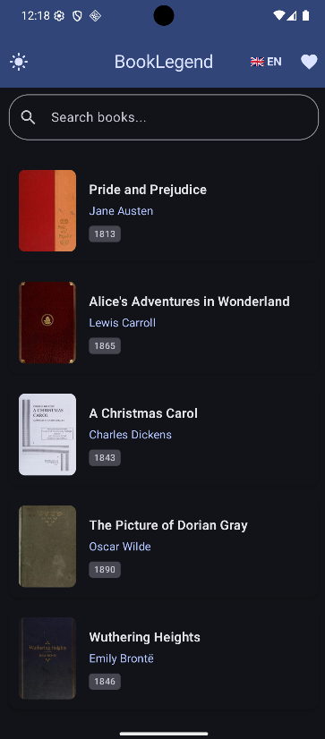
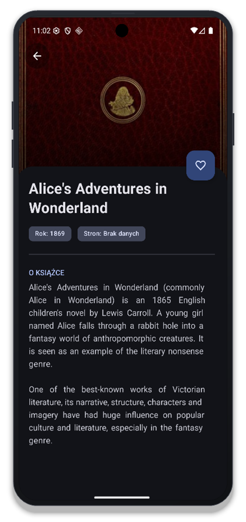
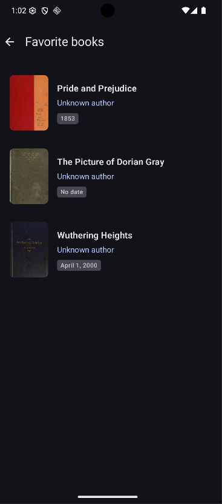
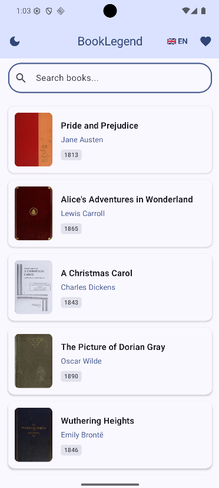

# 📚 Book Legend

[](https://github.com/Karman1818/BookLegend/actions/workflows/ci.yml)


A modern Android mobile application for browsing, searching, and collecting your favorite books. The app consumes the public **OpenLibrary** API and is built according to the latest **Modern Android Development** standards.

---

## 📱 Screenshots

<p align="center">
  
  
  
  
</p>

---

## ✨ Key Features

* **📖 Catalog Browsing:** Fetches popular books (Fiction category) from the OpenLibrary API.
* **♾️ Infinite Scroll (Pagination):** Automatically loads subsequent pages as the user scrolls, with a responsive bottom loading indicator.
* **🔄 Pull-to-Refresh:** Refresh the book catalog with a swipe-down gesture.
* **🔍 Live Search with Debounce:** Search books by title or author with automatic request debouncing and cancellation to avoid race conditions.
* **❤️ Favorites:** Add and remove books from your favorites list. Data is saved locally in persistent storage (DataStore).
* **🌙 Dark & Light Mode:** Seamless theme switching with persistent user preference across restarts.
* **🌐 In-App Language Switcher (i18n):** Switch dynamically between Polish (PL) and English (EN) from the app bar without restarting the app.
* **📱 Adaptive Book Details:** Modern bottom sheet with adaptive height (`BoxWithConstraints`) that gracefully stretches to the bottom of the viewport even for short descriptions.

---

## 🛠️ Tech Stack & Architecture

The project utilizes the **MVVM (Model-View-ViewModel)** architecture and **Clean Architecture** principles.

* **Language:** [Kotlin](https://kotlinlang.org/) (Coroutines, Flow, StateFlow)
* **UI Toolkit:** [Jetpack Compose](https://developer.android.com/jetpack/compose) (Material Design 3, Edge-to-Edge support)
* **Networking:** [Retrofit2](https://square.github.io/retrofit/) + [OkHttp3](https://square.github.io/okhttp/) (configured timeouts) + [Gson](https://github.com/google/gson)
* **Image Loading:** [Coil](https://coil-kt.github.io/coil/)
* **Local Storage:** [DataStore Preferences](https://developer.android.com/topic/libraries/architecture/datastore)
* **Navigation:** Jetpack Navigation Compose
* **Testing:** JUnit4, Google-recommended Test Fakes (`FakeBookApi`), Compose UI Testing (`createComposeRule`)
* **CI/CD:** GitHub Actions (Automated Unit Testing & Debug APK Build Artifacts)
* **Build System:** Gradle (Kotlin DSL)

---

## 🧪 Testing

The project includes both Unit and Instrumented UI tests following modern Android development practices:

* **Unit Tests (`src/test`):**
  * `BookRepositoryTest`: Verifies business logic, DTO mapping, and edge-case handling (null authors, negative cover IDs, description parsing from both String and Map formats) using a lightweight `FakeBookApi` (Google-recommended testing pattern).
  * Run unit tests:
    ```bash
    ./gradlew test
    ```

* **UI & Compose Tests (`src/androidTest`):**
  * `BookComponentsUiTest`: Tests Jetpack Compose UI components (`BookItem`, `EmptyStateView`, `ErrorView`), verifying proper rendering of titles, authors, and click callbacks using `createComposeRule()`.
  * Run instrumented tests:
    ```bash
    ./gradlew connectedAndroidTest
    ```

---

## ⚙️ Continuous Integration (CI)

A GitHub Actions pipeline (`.github/workflows/ci.yml`) is configured to run on every `push` and `pull_request` to the `main` branch:
1. **JDK 17 Setup & Gradle Caching** (`gradle/actions/setup-gradle@v4`)
2. **Automated Unit Tests** (`./gradlew testDebugUnitTest`)
3. **HTML Test Report Artifact Upload**
4. **Debug APK Build & Artifact Upload** (`app-debug.apk` available for download on GitHub Actions)

---

## 🚀 How to Run the Project

1. **Clone the repository:**
   ```bash
   git clone https://github.com/Karman1818/BookLegend.git
   ```
2. **Open in Android Studio:**
   Launch Android Studio, select "Open an existing project", and choose the `BookLegend` directory.
3. **Gradle Synchronization:**
   Wait for Android Studio to download dependencies and finish Gradle Sync.
4. **Run:**
   Connect a physical device or start an emulator (min. API 24) and press the ▶️ **Run** button.

---

## 📂 Project Structure

```text
com.example.booklegend
├── data                # Data Layer
│   ├── local           # DataStore Preferences (theme, language, favorites)
│   ├── model           # Domain models & API DTOs (Book, BookDetails)
│   ├── network         # Retrofit API interface & configured OkHttpClient
│   └── repository      # Repository with domain mapping & business logic
├── ui                  # Presentation Layer
│   ├── screens         # Compose Screens (Home, Detail, Favorites)
│   ├── theme           # Material3 Themes, Color Schemes, Typography
│   └── viewmodel       # ViewModels with StateFlow management
└── MainActivity.kt     # Single Activity entry point, Navigation & LocalizedApp wrapper
```
